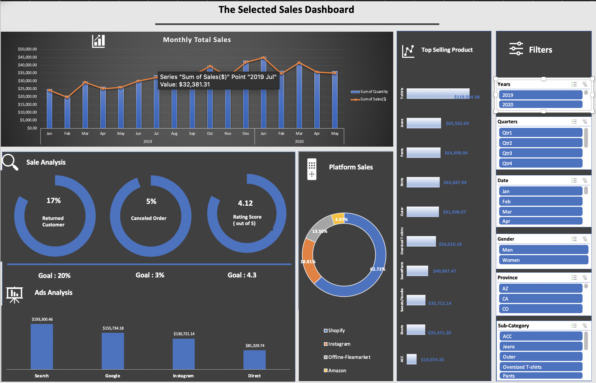

# 📊 E-Commerce Sales Performance & Dashboard Analysis

A clean, executive-ready sales dashboard and data analysis project built in Excel. This repository contains raw sales data, a standardized dataset, pivot analyses, and an interactive dashboard summarizing an online apparel seller's performance from **January 2019 to May 2020**.

**Skills:** data cleaning & translation · structured tables & calculated columns · pivot tables · slicers · KPI design · dashboard layout · automated verification in Python (pandas, openpyxl)



---

## 📌 Project Overview

This project analyzes **10,000+ transaction records** to evaluate key e-commerce sales metrics, channel performance, customer retention, and product category trends.

### Key Objectives
- **Data Cleaning & Standardization**: Converted Korean transactional data into English and added USD ($) price conversions alongside KRW (₩).
- **Pivot Summaries**: Aggregated key performance metrics including sales trends, platform share, return rates, and cancel rates.
- **Interactive Dashboard**: Designed a visual presentation layer to monitor sales KPIs at a glance, filterable by year, quarter, month, gender, state and sub-category.

---

## 🔑 Key Findings

| Metric | Result | Goal |
|---|---|---|
| Total sales (Jan 2019 – May 2020) | **$561,086** (19,566 units delivered; 20,699 incl. cancelled orders) | — |
| Returning customers | **16.9%** | 20% ⚠️ |
| Cancelled orders | **5.4%** | 3% ⚠️ |
| Average rating | **4.12 / 5** | 4.3 ⚠️ |

- **Growth:** monthly sales roughly doubled, from ~$24K in January 2019 to ~$45K in January 2020; December 2019 was the best month of 2019 ($41.9K).
- **Channels:** Shopify brings in **63%** of sales, Instagram 19%, offline flea markets 14%, Amazon 5%.
- **Ads:** search ads generate the most revenue ($193K), followed by Google ($156K), Instagram ($131K) and direct traffic ($81K).
- **Products:** T-shirts are the top sub-category at **$120K**, almost double the next (jeans, $66K); accessories are lowest ($19K).
- **Recommendation:** all three customer KPIs miss their goals, so the next priorities are a retention program (returning customers) and a look at why 1 in 20 orders is cancelled.

---

## 🛠️ Process

1. **Original data** — 10,329 rows with 16 Korean-language columns (date, district, category, quantity, price, channel, ad source, repeat purchase, cancellation, satisfaction).
2. **Cleaning** — translated headers and values into English, localized Seoul districts and Korean marketplaces to US states and platforms, standardized categories, converted Yes/No flags, and added `Price($)` and `Sales($)` calculated columns (KRW × 0.00078) inside an Excel table.
3. **Analysis** — seven pivot tables: monthly sales, platform share, return rate, cancel rate, average rating, sales by ad source, and top-selling sub-categories.
4. **Dashboard** — pivot charts and doughnut KPI gauges against goals, connected to slicers so every chart filters together.

| Original data | Cleaned data | Pivot tables |
|---|---|---|
|  |  |  |

---

## ✅ Automated Verification

[`verify_dashboard.py`](verify_dashboard.py) re-checks the workbook without opening Excel (and without modifying it):

- **Cleaning** — the English Data sheet matches the Korean original row for row (dates, quantities, prices, sales, ratings), USD = KRW × 0.00078 on every row, every Korean value was translated to exactly one English value, and cancelled orders carry no sales or rating.
- **Dashboard** — every number on the dashboard (17 monthly totals, platform shares, return/cancel rates, rating, ad sources, sub-categories) is recalculated with pandas and compared with the pivot tables.

```bash
pip install -r requirements.txt
python verify_dashboard.py      # 46/47 checks pass; exits 1 on any failure
python -m pytest -q             # also proves the checks catch altered data
```

GitHub Actions runs both on every push. Two things the verification surfaced:
- The dashboard's **units** figure counts cancelled orders (1,133 units); delivered units are 19,566.
- "SweatPants" and "Sweatpants" both appear in the Data sheet. Excel's pivot ignores case, so the dashboard total is correct, but tools that are case-sensitive (SQL, pandas, Power BI) would split them. Reported as a warning.

---

## 📂 Repository Structure

```
SelectedProject.xlsx   workbook: Original Data → Data → Pivot table → Dashboard sheets
verify_dashboard.py    recalculates and checks every dashboard number
tests/                 pytest suite for the verification script
DashBoard.png          dashboard screenshot
Original Data.png      raw Korean data
Sample data.png        cleaned, translated data
Pivot tables.png       pivot analyses
```

## ▶️ How to Use

Open `SelectedProject.xlsx` in Microsoft Excel (desktop recommended for slicers) and go to the **Dashboard** sheet. Use the slicers on the right to filter by year, quarter, month, gender, state or sub-category.
